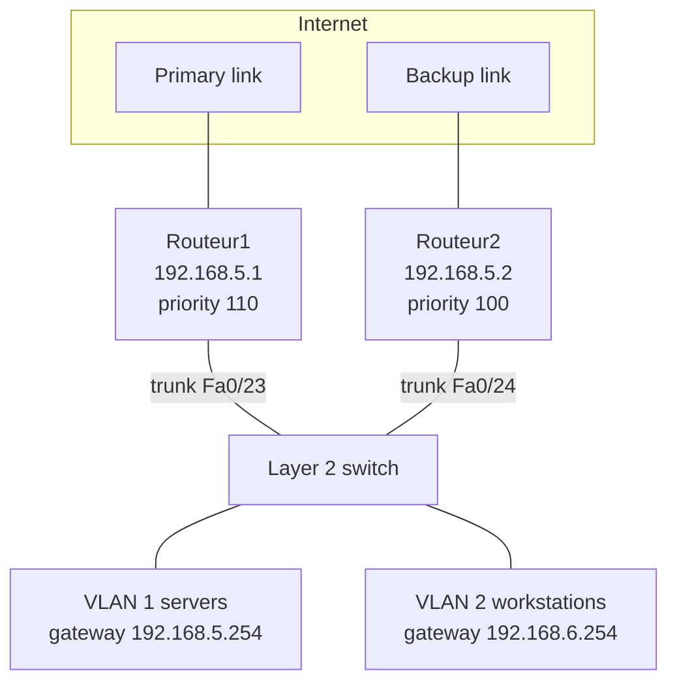

# 1. Cisco network: VLANs, HSRP and dual Internet access

[](README.md)
[](README.en.md)

## Network goals

- Separate the traffic of the internal LAN (servers, `192.168.5.0/24`) from the users' traffic (`192.168.6.0/24`).
- Have redundant Internet access: two routers, each with its own WAN link (Gi0/1).
- Keep a default gateway that never goes down, thanks to an HSRP virtual address.

## Hardware

- 2 physical Cisco routers
- 1 Cisco layer 2 switch
- Workstations plugged into any other port of the switch

## Cabling

| From | To | Role |
|---|---|---|
| Routeur1 Gi0/0 | Switch Fa0/23 | Trunk (VLAN 1 and 2) |
| Routeur1 Gi0/1 | Lab network | Primary Internet |
| Routeur2 Gi0/0 | Switch Fa0/24 | Trunk (VLAN 1 and 2) |
| Routeur2 Gi0/1 | Lab network | Backup Internet |

## VLANs

| VLAN | Network | Switch ports | Gateway (HSRP VIP) |
|---|---|---|---|
| 1: LAN (servers) | 192.168.5.0/24 | Fa0/2 to Fa0/12 | 192.168.5.254 |
| 2: USERS | 192.168.6.0/24 | Fa0/13 to Fa0/22 | 192.168.6.254 |

Each router does *router-on-a-stick*: one subinterface per VLAN on Gi0/0
(`encapsulation dot1Q`), and the switch carries both VLANs on its trunks.

## How the redundancy works (HSRP)



- Both routers share the virtual address `192.168.5.254` (VLAN 1) and `192.168.6.254` (VLAN 2).
  The machines use this address as their gateway, never the real address of a router.
- Routeur1 has priority 110, Routeur2 priority 100: Routeur1 is active.
- `track 1 interface GigabitEthernet0/1 line-protocol` watches the Internet link of Routeur1.
  If it goes down, its priority drops by 20 (110 - 20 = 90), which is below that of Routeur2 (100).
- With `preempt`, Routeur2 then takes over on its own, and Routeur1 takes back the role when its link returns.

Result: a failure of the primary link cuts neither the Internet nor the workstations' gateway.

How to prove it: [HSRP failover tests](tests-bascule-hsrp.en.md).

## Procedure (for each device)

1. Connect through the console port.
2. Reset the device:
   ```
   erase startup-config
   reload
   ```
3. Enter configuration mode (`enable`, then `configure terminal`): the prompt becomes `Routeur(config)#`.
4. Paste the configuration, then press ENTER.
5. Save it to the startup file:
   ```
   copy running-config startup-config
   ```

Complete configurations: [routeur1.cfg](configs/routeur1.cfg),
[routeur2.cfg](configs/routeur2.cfg), [switch.cfg](configs/switch.cfg).

## SNMP (for Zabbix)

The three devices send their metrics and traps to the Zabbix server (`192.168.5.100`):

- **read-only** community (`RO`);
- restricted by access list 10 to the Zabbix server only;
- traps enabled on the switch for links (`linkdown` / `linkup`), STP, MAC address changes and `errdisable` ports.

## Corrections made after submission

| Problem in the original document | Correction |
|---|---|
| `ip dhcp relay address` on the switch: invalid command, and a layer 2 switch does not route | `ip helper-address 192.168.5.50` on the VLAN 2 subinterface of both routers |
| The diagram gave `192.168.5.3` for Routeur2 | `192.168.5.2`, as in its configuration |
| `access-list 1 permit any` for NAT | NAT limited to the two internal networks |
| SNMP open to everyone | Community restricted to the Zabbix server (ACL 10) |
| Zabbix polled the switch on `192.168.6.254` (the HSRP address of the routers) | The management address of the switch is `192.168.6.177` |

## Going further

- Replace password-based Telnet access (`line vty`) with SSH and a local account (`transport input ssh`, `login local`).
- Move from SNMPv2c to **SNMPv3** (authentication and encryption).
