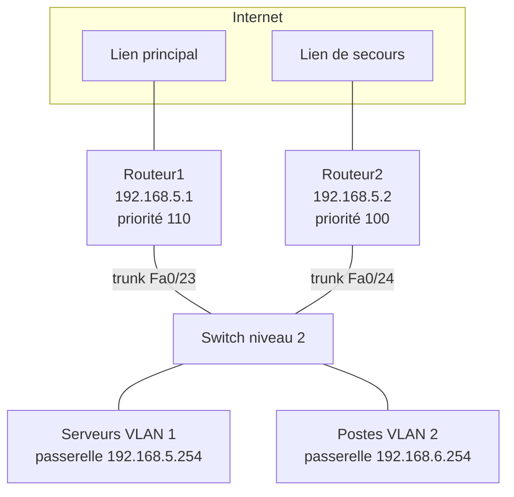

# 1. Réseau Cisco : VLAN, HSRP et double accès Internet

## Objectifs réseau

- Séparer le trafic du LAN interne (serveurs, `192.168.5.0/24`) et celui des utilisateurs (`192.168.6.0/24`).
- Avoir un accès Internet redondant : deux routeurs, chacun avec son propre lien WAN (Gi0/1).
- Garder une passerelle par défaut qui ne tombe jamais, grâce à une adresse virtuelle HSRP.

## Matériel

- 2 routeurs Cisco physiques
- 1 commutateur Cisco de niveau 2
- Postes de travail branchés sur n'importe quel autre port du commutateur

## Câblage

| De | Vers | Rôle |
|---|---|---|
| Routeur1 Gi0/0 | Switch Fa0/23 | Trunk (VLAN 1 et 2) |
| Routeur1 Gi0/1 | Réseau du laboratoire | Internet principal |
| Routeur2 Gi0/0 | Switch Fa0/24 | Trunk (VLAN 1 et 2) |
| Routeur2 Gi0/1 | Réseau du laboratoire | Internet de secours |

## VLAN

| VLAN | Réseau | Ports du switch | Passerelle (VIP HSRP) |
|---|---|---|---|
| 1 : LAN (serveurs) | 192.168.5.0/24 | Fa0/2 à Fa0/12 | 192.168.5.254 |
| 2 : USERS | 192.168.6.0/24 | Fa0/13 à Fa0/22 | 192.168.6.254 |

Chaque routeur fait du *router-on-a-stick* : une sous-interface par VLAN sur Gi0/0
(`encapsulation dot1Q`), et le switch transporte les deux VLAN sur ses trunks.

## Comment fonctionne la redondance (HSRP)



- Les deux routeurs partagent l'adresse virtuelle `192.168.5.254` (VLAN 1) et `192.168.6.254` (VLAN 2).
  Les machines utilisent cette adresse comme passerelle, jamais l'adresse réelle d'un routeur.
- Routeur1 a la priorité 110, Routeur2 la priorité 100 : Routeur1 est actif.
- `track 1 interface GigabitEthernet0/1 line-protocol` surveille le lien Internet de Routeur1.
  S'il tombe, sa priorité baisse de 20 (110 - 20 = 90), donc passe sous celle de Routeur2 (100).
- Avec `preempt`, Routeur2 prend alors la main tout seul, et Routeur1 la reprend quand son lien revient.

Résultat : une panne du lien principal ne coupe ni Internet ni la passerelle des postes.

Procédure pour le prouver : [tests de bascule HSRP](tests-bascule-hsrp.md).

## Procédure (pour chaque équipement)

1. Se connecter par le port console.
2. Remettre l'équipement à zéro :
   ```
   erase startup-config
   reload
   ```
3. Passer en mode configuration (`enable`, puis `configure terminal`) : l'invite devient `Routeur(config)#`.
4. Coller la configuration, puis appuyer sur ENTRÉE.
5. Sauvegarder dans le fichier de démarrage :
   ```
   copy running-config startup-config
   ```

Configurations complètes : [routeur1.cfg](configs/routeur1.cfg),
[routeur2.cfg](configs/routeur2.cfg), [switch.cfg](configs/switch.cfg).

## SNMP (pour Zabbix)

Les trois équipements envoient leurs métriques et leurs traps au serveur Zabbix (`192.168.5.100`) :

- communauté en **lecture seule** (`RO`) ;
- limitée par la liste d'accès 10 au seul serveur Zabbix ;
- traps activés sur le switch pour les liens (`linkdown` / `linkup`), STP, changements d'adresses MAC et ports en `errdisable`.

## Corrections apportées après le rendu

| Problème dans le document original | Correction |
|---|---|
| `ip dhcp relay address` sur le switch : commande invalide, et un switch de niveau 2 ne route pas | `ip helper-address 192.168.5.50` sur la sous-interface VLAN 2 des deux routeurs |
| Le schéma donnait `192.168.5.3` pour Routeur2 | `192.168.5.2`, comme dans sa configuration |
| `access-list 1 permit any` pour le NAT | NAT limité aux deux réseaux internes |
| SNMP ouvert à tout le monde | communauté limitée au serveur Zabbix (ACL 10) |
| Zabbix interrogeait le switch sur `192.168.6.254` (l'adresse HSRP des routeurs) | l'adresse de gestion du switch est `192.168.6.177` |

## Pour aller plus loin

- Remplacer l'accès Telnet par mot de passe (`line vty`) par SSH avec un compte local (`transport input ssh`, `login local`).
- Passer de SNMPv2c à **SNMPv3** (authentification et chiffrement).
