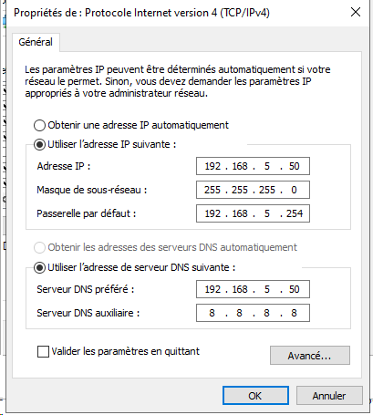
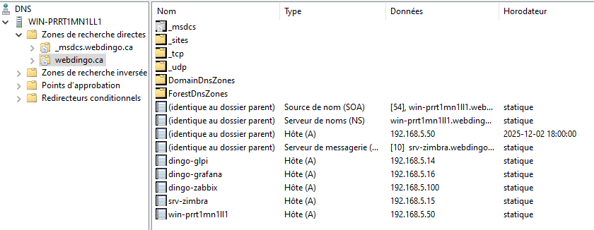
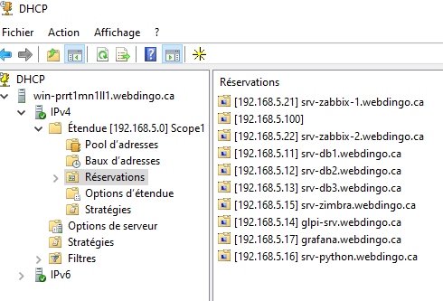

# 2. Active Directory, DNS and DHCP (Windows Server 2022)

This section describes the Windows infrastructure:

- **Active Directory** for user accounts and groups;
- **DNS** for internal name resolution (`webdingo.ca`);
- **DHCP** to hand out IP addresses to the workstations automatically.

Everything else in the project (GLPI, Zabbix, Zimbra) depends on this server.

## Server network settings

| Setting | Value |
|---|---|
| Server | `srv-ad.webdingo.ca` |
| IP address | 192.168.5.50/24 |
| Gateway | 192.168.5.254 (HSRP virtual address) |
| Preferred DNS | 192.168.5.50 (itself) |
| AD domain | `webdingo.ca` |

## Installing the domain controller

1. In Server Manager, add the **AD DS** and **DNS Server** roles.
2. Promote the server to a domain controller:
   - create a new forest: `webdingo.ca`;
   - choose the functional level (Windows Server 2016 or later);
   - set the DSRM password.
3. Restart the server.

The directory is organized in organizational units by department (Finances, Informatique,
Logistique, Marketing, Opérations, Ressources humaines, Sécurité TI, Support technique, Ventes...).
The Python scripts rely on these OUs to create the groups in GLPI.

## DNS: `webdingo.ca` zone

| Host name | Type | Data | Use |
|---|---|---|---|
| srv-ad | A | 192.168.5.50 | Domain controller / DNS / DHCP |
| dingo-zabbix | A | 192.168.5.100 | Zabbix monitoring |
| dingo-glpi | A | 192.168.5.14 | GLPI |
| srv-zimbra | A | 192.168.5.15 | Zimbra email |
| dingo-grafana | A | 192.168.5.17 | Grafana |
| @ (webdingo.ca) | MX | srv-zimbra.webdingo.ca | Mail server |

> The screenshot shows the old entry `dingo-grafana → 192.168.5.16`. Grafana actually runs
> on `192.168.5.17` (DHCP reservation and Zabbix agent); `.16` is the Python scripts server.

## DHCP

**Internal LAN scope (`192.168.5.0/24`)**

- Name: `LAN-WebDingo`
- Range: 192.168.5.101 to 192.168.5.200 (192.168.5.100 is the Zabbix address)
- Gateway: 192.168.5.254 (HSRP virtual address)
- DNS: 192.168.5.50
- The servers have a **reservation** (fixed address tied to their MAC address).

**USERS scope (`192.168.6.0/24`)**

- Name: `USERS-WebDingo`
- Range: 192.168.6.100 to 192.168.6.200
- Gateway: 192.168.6.254 (HSRP virtual address of VLAN 2)
- DNS: 192.168.5.50
- Requests arrive through the DHCP relay of the routers (`ip helper-address`).

> Correction compared with the original document: the gateway handed out was the real address
> of Routeur1. With it, a failure of Routeur1 cut off the workstations despite HSRP; it is now
> the virtual address.
