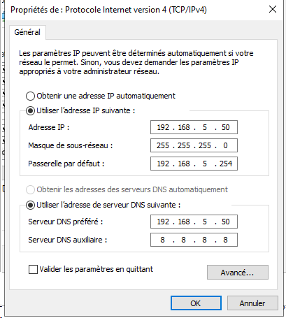
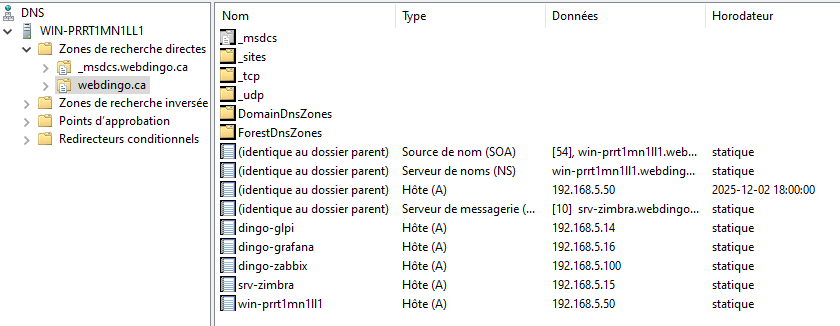
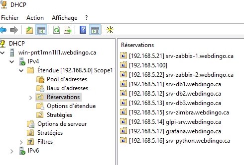

# 2. Active Directory, DNS et DHCP (Windows Server 2022)

Cette section décrit l'infrastructure Windows :

- **Active Directory** pour les comptes utilisateurs et les groupes ;
- **DNS** pour la résolution des noms internes (`webdingo.ca`) ;
- **DHCP** pour attribuer automatiquement les adresses IP aux postes.

Tout le reste du projet (GLPI, Zabbix, Zimbra) dépend de ce serveur.

## Paramètres réseau du serveur

| Paramètre | Valeur |
|---|---|
| Serveur | `srv-ad.webdingo.ca` |
| Adresse IP | 192.168.5.50/24 |
| Passerelle | 192.168.5.254 (adresse virtuelle HSRP) |
| DNS préféré | 192.168.5.50 (lui-même) |
| Domaine AD | `webdingo.ca` |

## Installation du contrôleur de domaine

1. Dans le Gestionnaire de serveur, ajouter les rôles **Services AD DS** et **Serveur DNS**.
2. Promouvoir le serveur en contrôleur de domaine :
   - créer une nouvelle forêt : `webdingo.ca` ;
   - choisir le niveau fonctionnel (Windows Server 2016 ou plus récent) ;
   - définir le mot de passe DSRM.
3. Redémarrer le serveur.

L'annuaire est organisé en unités d'organisation par département (Finances, Informatique,
Logistique, Marketing, Opérations, Ressources humaines, Sécurité TI, Support technique, Ventes…).
Les scripts Python s'appuient sur ces OU pour créer les groupes dans GLPI.

## DNS : zone `webdingo.ca`

| Nom d'hôte | Type | Donnée | Utilisation |
|---|---|---|---|
| srv-ad | A | 192.168.5.50 | Contrôleur de domaine / DNS / DHCP |
| dingo-zabbix | A | 192.168.5.100 | Supervision Zabbix |
| dingo-glpi | A | 192.168.5.14 | GLPI |
| srv-zimbra | A | 192.168.5.15 | Messagerie Zimbra |
| dingo-grafana | A | 192.168.5.17 | Grafana |
| @ (webdingo.ca) | MX | srv-zimbra.webdingo.ca | Serveur de messagerie |

> La capture montre l'ancienne entrée `dingo-grafana → 192.168.5.16`. Grafana est en réalité
> sur `192.168.5.17` (réservation DHCP et agent Zabbix) ; `.16` est le serveur de scripts Python.

## DHCP

**Étendue LAN interne (`192.168.5.0/24`)**

- Nom : `LAN-WebDingo`
- Plage : 192.168.5.101 à 192.168.5.200 (192.168.5.100 est l'adresse de Zabbix)
- Passerelle : 192.168.5.254 (adresse virtuelle HSRP)
- DNS : 192.168.5.50
- Les serveurs ont une **réservation** (adresse fixe liée à leur adresse MAC).

**Étendue USERS (`192.168.6.0/24`)**

- Nom : `USERS-WebDingo`
- Plage : 192.168.6.100 à 192.168.6.200
- Passerelle : 192.168.6.254 (adresse virtuelle HSRP du VLAN 2)
- DNS : 192.168.5.50
- Les demandes arrivent par le relais DHCP des routeurs (`ip helper-address`).

> Correction par rapport au document original : la passerelle distribuée était l'adresse réelle
> de Routeur1. Avec elle, une panne de Routeur1 coupait les postes malgré HSRP ; c'est maintenant
> l'adresse virtuelle.
