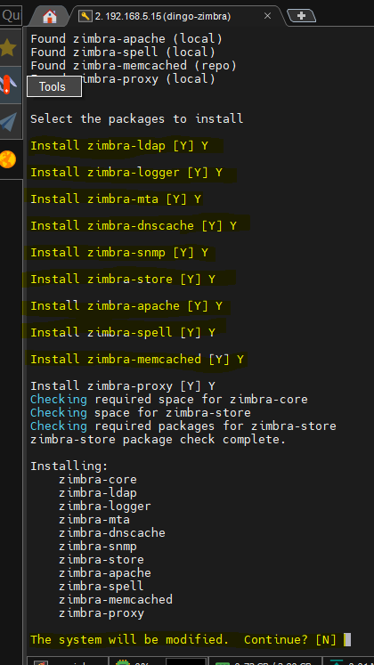
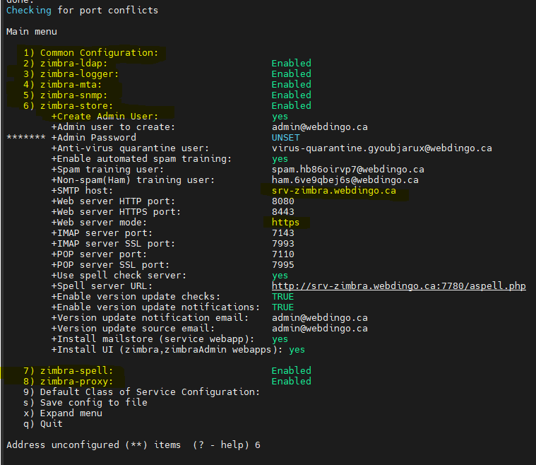
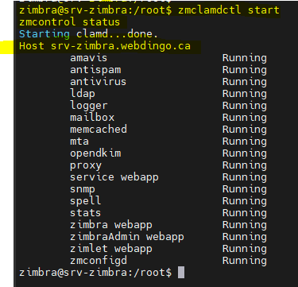
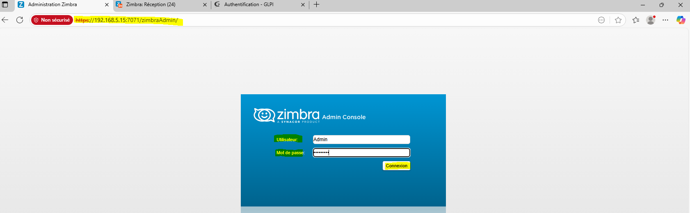

# 3. Zimbra email

[](README.md)
[](README.en.md)

Zimbra is the internal mail server of WebDingo. It is used to receive the Zabbix alerts by
email, to manage the mailboxes of the `@webdingo.ca` users and to give the client a
centralized email service.

## Network and DNS preparation

| Setting | Value |
|---|---|
| Server | `srv-zimbra.webdingo.ca` (Ubuntu 22.04) |
| IP address | 192.168.5.15/24 |
| Gateway | 192.168.5.254 |
| DNS | 192.168.5.50 (AD server) |

In the AD DNS: an **A** record `srv-zimbra → 192.168.5.15` and an **MX** record
`webdingo.ca → srv-zimbra.webdingo.ca`. On the server, the `/etc/hosts` file contains:

```
192.168.5.15   srv-zimbra.webdingo.ca   srv-zimbra
```

## Installation

1. Update the system and install the prerequisites.
2. Extract the Zimbra archive (10.1) and run `install.sh`.
3. Install every package: ldap, logger, mta, dnscache, snmp, store, apache, spell, memcached, proxy.

   
4. During the configuration: *Zimbra Collaboration Server*, hostname `srv-zimbra.webdingo.ca`,
   password of the `admin@webdingo.ca` account.

   
5. At the end, every service must be in the *Running* state:
   ```
   su - zimbra
   zmcontrol status
   ```
   

The administration console answers on `https://192.168.5.15:7071/zimbraAdmin/`.



## Integration with Active Directory

Zimbra does not keep the passwords itself: authentication is delegated to AD (LDAP).

### Automatic account creation (autoprovisioning)

So that Zimbra creates the mailboxes of the AD users automatically, the file
[autoprov.txt](configs/autoprov.txt) is applied as the `zimbra` user:

```
su - zimbra
zmprov -f /tmp/autoprov.txt
```

Effect:

- Zimbra queries AD every minute;
- it creates the `prenom.nom@webdingo.ca` accounts (first name, last name) from the AD information;
- it sends a welcome email to the new user.

> The original document used the domain Administrator account for the LDAP bind.
> A read-only service account is enough, and that is what the published file shows.
