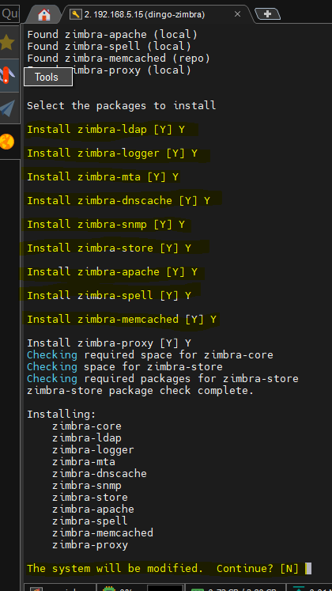
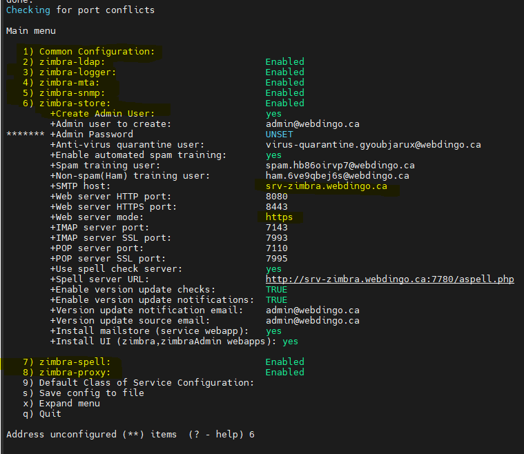
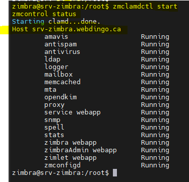
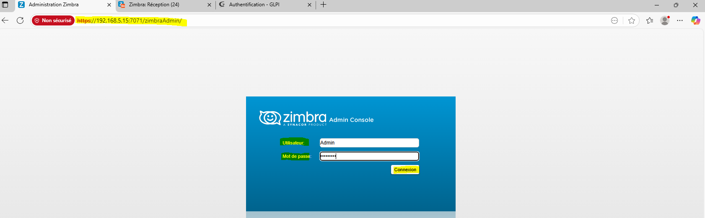

# 3. Messagerie Zimbra

Zimbra sert de serveur de messagerie interne pour WebDingo. Il est utilisé pour recevoir les
alertes Zabbix par courriel, gérer les boîtes aux lettres des utilisateurs `@webdingo.ca` et
offrir au client une messagerie centralisée.

## Préparation réseau et DNS

| Paramètre | Valeur |
|---|---|
| Serveur | `srv-zimbra.webdingo.ca` (Ubuntu 22.04) |
| Adresse IP | 192.168.5.15/24 |
| Passerelle | 192.168.5.254 |
| DNS | 192.168.5.50 (serveur AD) |

Dans le DNS de l'AD : un enregistrement **A** `srv-zimbra → 192.168.5.15` et un **MX**
`webdingo.ca → srv-zimbra.webdingo.ca`. Sur le serveur, le fichier `/etc/hosts` contient :

```
192.168.5.15   srv-zimbra.webdingo.ca   srv-zimbra
```

## Installation

1. Mettre le système à jour et installer les prérequis.
2. Décompresser l'archive Zimbra (10.1) et lancer `install.sh`.
3. Installer tous les paquets : ldap, logger, mta, dnscache, snmp, store, apache, spell, memcached, proxy.

   
4. Pendant la configuration : *Zimbra Collaboration Server*, hostname `srv-zimbra.webdingo.ca`,
   mot de passe du compte `admin@webdingo.ca`.

   
5. À la fin, tous les services doivent être à l'état *Running* :
   ```
   su - zimbra
   zmcontrol status
   ```
   

La console d'administration répond sur `https://192.168.5.15:7071/zimbraAdmin/`.



## Intégration avec Active Directory

Zimbra ne garde pas les mots de passe lui-même : l'authentification est déléguée à l'AD (LDAP).

### Création automatique des comptes (autoprovisioning)

Pour que Zimbra crée automatiquement les boîtes des utilisateurs AD, le fichier
[autoprov.txt](configs/autoprov.txt) est appliqué en tant qu'utilisateur `zimbra` :

```
su - zimbra
zmprov -f /tmp/autoprov.txt
```

Effet :

- Zimbra interroge l'AD toutes les minutes ;
- il crée les comptes `prenom.nom@webdingo.ca` à partir des informations de l'AD ;
- il envoie un courriel de bienvenue au nouvel utilisateur.

> Le document original utilisait le compte Administrateur du domaine pour la liaison LDAP.
> Un compte de service en lecture seule suffit, et c'est ce que montre le fichier publié.
