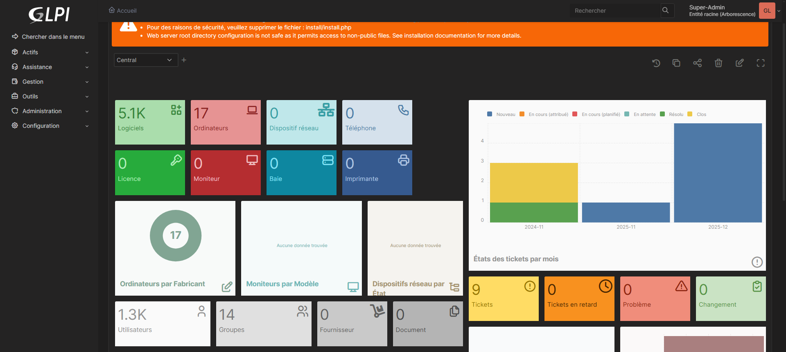
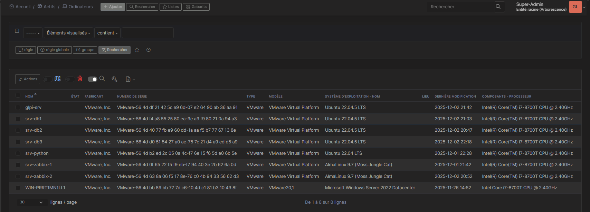

# 4. GLPI: incident management and inventory

GLPI is the tool WebDingo uses to manage incident tickets (outages, user requests) and to
centralize the inventory of servers and equipment. It also receives tickets automatically
when Zabbix detects a critical alert (see
[the automation](../07-automation-python/README.en.md)).

## Installation

| Setting | Value |
|---|---|
| Server | `dingo-glpi.webdingo.ca` (Ubuntu 22.04) |
| IP address | 192.168.5.14/24 |
| Access | `http://dingo-glpi/glpi` |

1. Install Apache, PHP and MariaDB.
2. Create a `glpi` database and a dedicated user (e.g. `glpi_user`).
3. Copy the GLPI files to `/var/www/html/glpi`.
4. Open the server address in a browser and follow the wizard: French language,
   database connection, table creation.
5. Log in with the default `glpi` / `glpi` account, then **change every default password**.
6. **Delete `install/install.php`**: GLPI requires it (orange banner in the screenshot below).

## Basic configuration

1. **Main entity**: *Administration > Entities*, rename the root entity to
   `WebDingo Solutions Inc.` It holds every user and every ticket.
2. **Profiles**:
   - *Super-Admin*: technical team;
   - *Network technician* (*Technicien réseau*): tickets, planning, inventory;
   - *User* (*Utilisateur*): can create tickets and follow their status.
3. **Ticket categories** (*Setup > Dropdowns > Ticket categories*):
   Réseau / Internet, Serveurs et services, Messagerie / Zimbra, Supervision / Zabbix
   (network / Internet, servers and services, email / Zimbra, monitoring / Zabbix).

## Integration with Active Directory (LDAP)

To avoid managing accounts in two places, GLPI is linked to AD:
users log in with their domain account.

*Setup > Authentication > LDAP directories*:

| Setting | Value |
|---|---|
| Name | Active Directory |
| Server | 192.168.5.50 |
| Port | 389 |
| Base DN | `DC=webdingo,DC=ca` |
| Target entity | WebDingo Solutions Inc. |
| Default profile | User (no administration rights) |

Users are imported by the Python scripts (with their group based on their OU),
or created at their first login.

## Inventory

The project servers appear in the GLPI inventory (VMware virtual machines):

## Validation

1. **Login with an AD account**: log in with `prenom.nom@webdingo.ca` and the domain password.
2. **Manual ticket**: *Assistance > Tickets*, category *Réseau / Internet*, requester = an AD user.
   The ticket appears with the *New* status.
3. **Automatic ticket**: force a critical trigger in Zabbix. The script creates a ticket
   with the right title (e.g. "ALERTE RÉSEAU : Routeur 1 - Saturation du lien entrant",
   that is, network alert: Router 1, inbound link saturation), the right priority and
   diagnostic tasks.
