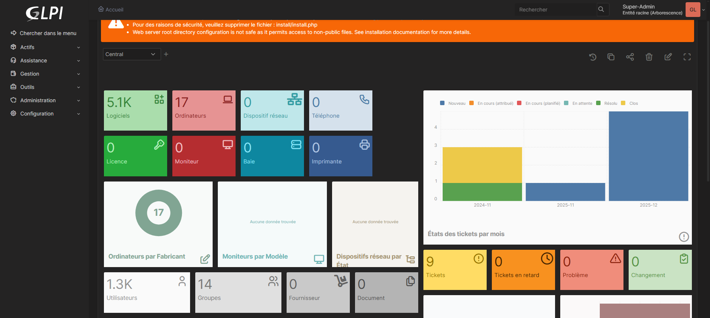
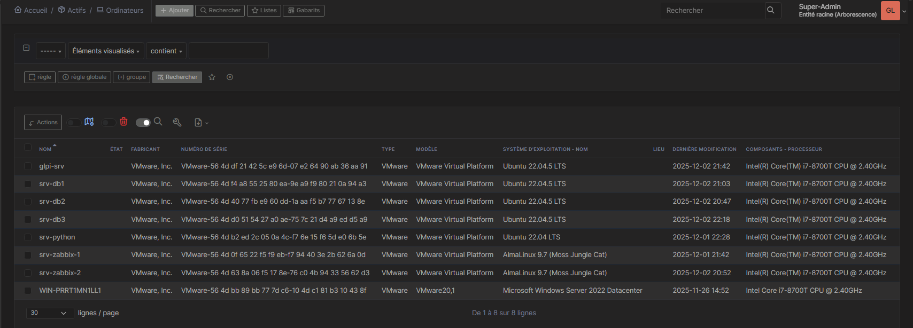

# 4. GLPI : gestion des incidents et inventaire

GLPI est l'outil utilisé par WebDingo pour gérer les tickets d'incidents (pannes, demandes des
usagers) et centraliser l'inventaire des serveurs et équipements. Il reçoit aussi
automatiquement des tickets quand Zabbix détecte une alerte critique (voir
[l'automatisation](../07-automation-python/)).

## Installation

| Paramètre | Valeur |
|---|---|
| Serveur | `dingo-glpi.webdingo.ca` (Ubuntu 22.04) |
| Adresse IP | 192.168.5.14/24 |
| Accès | `http://dingo-glpi/glpi` |

1. Installer Apache, PHP et MariaDB.
2. Créer une base `glpi` et un utilisateur dédié (ex. `glpi_user`).
3. Copier les fichiers de GLPI dans `/var/www/html/glpi`.
4. Ouvrir l'adresse du serveur dans un navigateur et suivre l'assistant : langue française,
   connexion à la base, création des tables.
5. Se connecter avec le compte par défaut `glpi` / `glpi`, puis **changer tous les mots de passe par défaut**.
6. **Supprimer `install/install.php`** : GLPI l'exige (bandeau orange sur la capture ci-dessous).

## Configuration de base

1. **Entité principale** : *Administration > Entités*, renommer l'entité racine en
   `WebDingo Solutions Inc.` Elle contient tous les utilisateurs et tous les tickets.
2. **Profils** :
   - *Super-Admin* : équipe technique ;
   - *Technicien réseau* : tickets, planning, inventaire ;
   - *Utilisateur* : peut créer des tickets et suivre leur état.
3. **Catégories de tickets** (*Configuration > Intitulés > Catégories de tickets*) :
   Réseau / Internet, Serveurs et services, Messagerie / Zimbra, Supervision / Zabbix.

## Intégration avec Active Directory (LDAP)

Pour éviter de gérer les comptes à deux endroits, GLPI est relié à l'AD :
les utilisateurs se connectent avec leur compte du domaine.

*Configuration > Authentification > Annuaires LDAP* :

| Paramètre | Valeur |
|---|---|
| Nom | Active Directory |
| Serveur | 192.168.5.50 |
| Port | 389 |
| Base DN | `DC=webdingo,DC=ca` |
| Entité cible | WebDingo Solutions Inc. |
| Profil par défaut | Utilisateur (sans droits d'administration) |

Les utilisateurs sont importés par les scripts Python (avec leur groupe d'après leur OU),
ou créés à leur première connexion.

## Inventaire

Les serveurs du projet remontent dans l'inventaire GLPI (machines virtuelles VMware) :

## Validation

1. **Connexion avec un compte AD** : se connecter avec `prenom.nom@webdingo.ca` et le mot de passe du domaine.
2. **Ticket manuel** : *Assistance > Tickets*, catégorie *Réseau / Internet*, demandeur = un utilisateur AD.
   Le ticket apparaît avec le statut *Nouveau*.
3. **Ticket automatique** : forcer un déclencheur critique dans Zabbix. Le script crée un ticket
   avec le bon titre (ex. « ALERTE RÉSEAU : Routeur 1 - Saturation du lien entrant »),
   la bonne priorité et des tâches de diagnostic.
