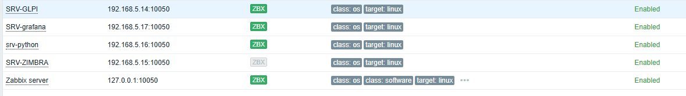
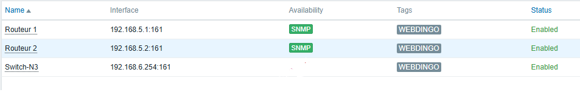
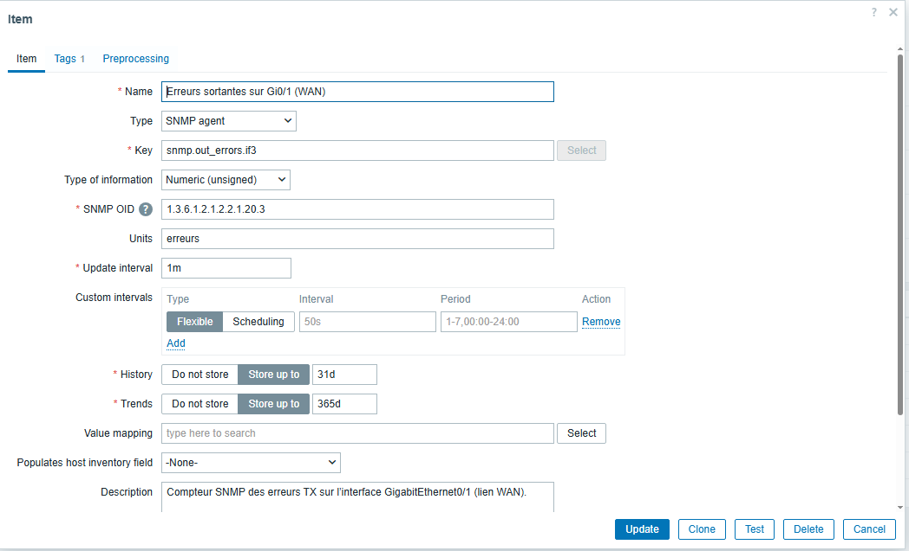
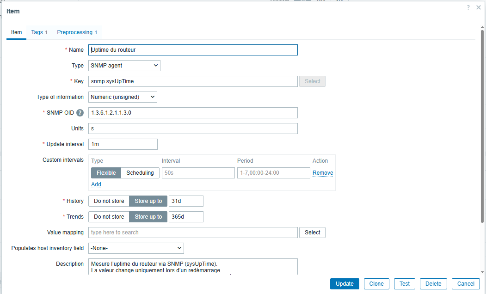
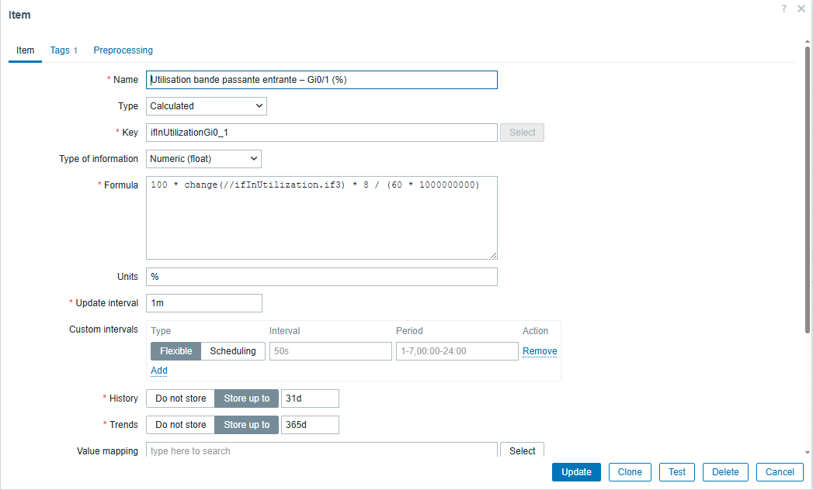

# 5. Zabbix monitoring

[](README.md)
[](README.en.md)

The goal is to monitor the WebDingo network infrastructure, especially:

- the primary router and its WAN link (Gi0/1);
- errors and dropped packets (*discards*) on the WAN interface;
- bandwidth;
- network availability (ping, latency, packet loss).

Zabbix must be able to:

- collect reliable metrics (CPU, RAM, errors, traffic...);
- fire **WARNING** alerts to warn before the outage;
- fire **HIGH** alerts when the problem really affects users;
- send emails and create GLPI tickets through the Python scripts.

## High-availability architecture

| Role | Machines | System |
|---|---|---|
| Zabbix server (high availability) | srv-zabbix-1 (192.168.5.21), srv-zabbix-2 (192.168.5.22) | AlmaLinux 9 |
| Zabbix access address / SNMP target | 192.168.5.100 | |
| Database | srv-db1, srv-db2, srv-db3 (192.168.5.11 to .13) | Ubuntu 22.04 |

Two Zabbix nodes: if the active node goes down, the second one takes over. The data is
stored on three dedicated database servers.

Linux servers are monitored by the Zabbix agent, Cisco devices by SNMP:




## Template and hosts

Every network metric is grouped in one template, `Webdingotemplate`, linked to the
hosts Routeur 1, Routeur 2 and the switch: *Data collection > Hosts > (host) > Templates > Link new template*.

## Monitored metrics

| Device | Metric | Zabbix key | WARNING | HIGH | Why |
|---|---|---|---|---|---|
| Router | Gi0/1 status | `if.operstatus.if3` | | port DOWN | Loss of the primary Internet link |
| Router | CPU | `system.cpu.util` | > 60 % over 5 min | > 90 % over 5 min | CPU too high = slowness or outage |
| Router | Memory | `vm.memory.util` | > 70 % | > 90 % | Risk of instability |
| Router | Established TCP connections | `tcp.established.count` | > 100 | > 200 | Overload or attack (DoS) |
| Router | Gi0/1 inbound errors | `snmp.in_errors.if3` | > 10 / 5 min | > 100 / 5 min | Physical problem or saturated link |
| Router | Gi0/1 outbound errors | `snmp.out_errors.if3` | > 5 | > 20 | Cable, port or congestion |
| Router | Outbound dropped packets | `ip.out.discards` | > 50 / 5 min | > 200 / 5 min | Congestion, losses for the services |
| Router | Gi0/1 inbound bandwidth | `ifInUtilizationGi0_1` (calculated) | > 60 % over 5 min | > 85 % over 5 min | Saturated link = slow Internet |
| Router | VLAN 1 inbound traffic | `ifInUtilization.if7` | > 500,000 bytes/s | > 2,000,000 bytes/s | Server VLAN too busy |
| Router | ICMP latency | `icmppingsec` | > 100 ms over 5 min | > 300 ms or timeout | Slow or failed Internet |
| Router | ICMP packet loss | `icmppingloss[192.168.5.1]` | > 10 % | > 50 % | Degraded link quality |
| Router | Uptime | `snmp.sysUpTime` | < 1 h | < 5 min | Unexpected restart |
| Servers | CPU (agent) | `system.cpu.util` | > 70 % | > 90 % | Service performance |
| Servers | Disk space `/` | `vfs.fs.size[/,pfree]` | < 20 % free | < 10 % free | Risk of outage |

### Item examples

**Outbound errors on Gi0/1**: number of packets the WAN interface tried to send but that
were lost because of an error (faulty cable, congestion, failing port). A stable interface
should stay at 0: it is one of the best indicators of a physical problem.



**Router uptime**: how long the router has been running without interruption. A low value
means a recent restart (crash, power cut, hardware problem).



**Inbound bandwidth in %**: the raw value (bytes received on Gi0/1, OID `1.3.6.1.2.1.2.2.1.10.3`)
is used to calculate a percentage, more meaningful to an administrator than bytes:

```
100 * change(//ifInUtilization.if3) * 8 / (60 * 1000000000)
```

(bytes received in one minute, converted to bits, divided by the capacity of the 1 Gbit/s link over 60 seconds)



## My triggers (network and security part)

| Trigger | Severity | Expression |
|---|---|---|
| High number of TCP connections | Warning / High | High: `avg(/Webdingotemplate/tcp.established.count,5m)>100` |
| High rate of outbound dropped packets | Warning / High | on `ip.out.discards` |
| Inbound link saturation | Warning / High | on `snmp.in_bytes.if3` |
| Inbound error rate on the interface | Warning / High | on `snmp.in_errors.if3` |

## Other team triggers

| Trigger | Severity | Expression |
|---|---|---|
| Outbound errors > 5 | Warning | `last(/Webdingotemplate/snmp.out_errors.if3)>5` |
| Outbound errors > 20 | High | `last(/Webdingotemplate/snmp.out_errors.if3)>20` |
| High ICMP packet loss | Warning | `last(/Webdingotemplate/icmppingloss[192.168.5.1])>10` |
| Very high ICMP packet loss | High | `last(/Webdingotemplate/icmppingloss[192.168.5.1])>50` |
| Recent restart (uptime < 1 h) | Warning | `last(/Webdingotemplate/snmp.sysUpTime)<3600` |
| Critical restart (uptime < 5 min) | High | `last(/Webdingotemplate/snmp.sysUpTime)<300` |
| Inbound bandwidth > 60 % / 5 min | Warning | `avg(/Webdingotemplate/ifInUtilizationGi0_1,5m)>60` |
| Inbound bandwidth > 85 % / 5 min | High | `avg(/Webdingotemplate/ifInUtilizationGi0_1,5m)>85` |
| VLAN 1 inbound traffic | Warning | `last(/Webdingotemplate/ifInUtilization.if7)>500000` |
| VLAN 1 inbound traffic | High | `last(/Webdingotemplate/ifInUtilization.if7)>2000000` |

> The expressions above were aligned with the justified thresholds (10 % and 50 % loss,
> 60 % and 85 % bandwidth): the bandwidth item is already a percentage.

## Tests

The triggers were tested by causing the condition (for example by saturating the inbound
link), then checking the problem in *Monitoring > Problems*: the Warning alerts, then the
High ones, appear on Routeur 1 and Routeur 2.
