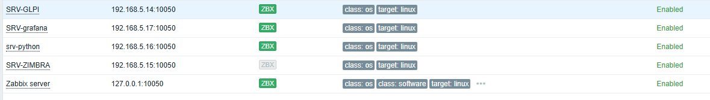
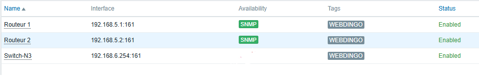
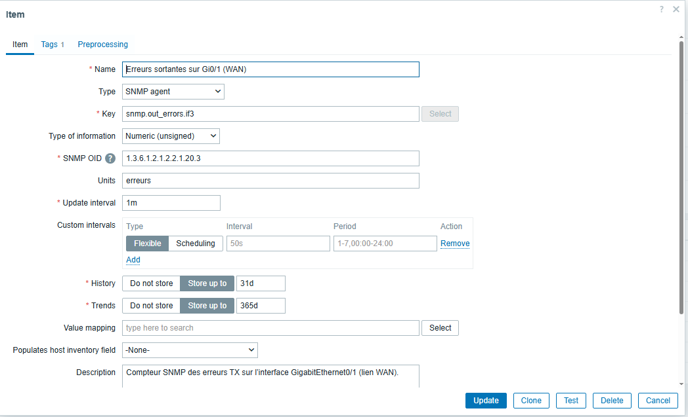
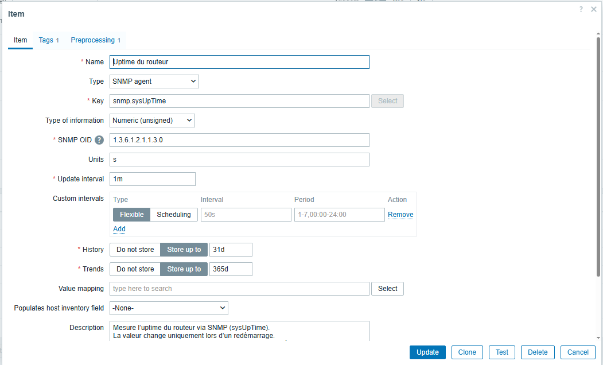
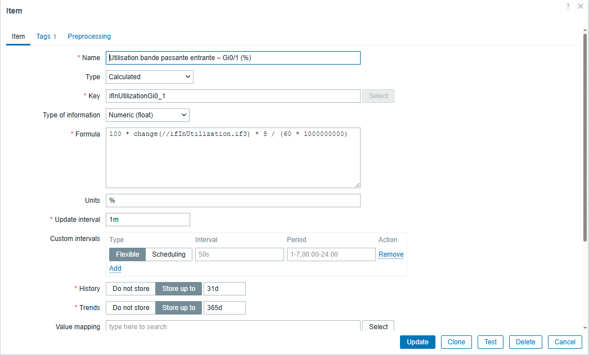

# 5. Supervision Zabbix

Le but est de surveiller l'infrastructure réseau de WebDingo, surtout :

- le routeur principal et son lien WAN (Gi0/1) ;
- les erreurs et les paquets rejetés (*discards*) sur l'interface WAN ;
- la bande passante ;
- la disponibilité réseau (ping, latence, perte de paquets).

Zabbix doit être capable de :

- remonter des métriques fiables (CPU, RAM, erreurs, trafic…) ;
- déclencher des alertes **WARNING** pour prévenir avant la panne ;
- déclencher des alertes **HIGH** quand le problème touche vraiment les utilisateurs ;
- envoyer des courriels et créer des tickets GLPI par les scripts Python.

## Architecture en haute disponibilité

| Rôle | Machines | Système |
|---|---|---|
| Serveur Zabbix (haute disponibilité) | srv-zabbix-1 (192.168.5.21), srv-zabbix-2 (192.168.5.22) | AlmaLinux 9 |
| Adresse d'accès Zabbix / cible SNMP | 192.168.5.100 | |
| Base de données | srv-db1, srv-db2, srv-db3 (192.168.5.11 à .13) | Ubuntu 22.04 |

Deux nœuds Zabbix : si le nœud actif tombe, le second prend le relais. Les données sont
stockées sur trois serveurs de base de données dédiés.

Les serveurs Linux sont supervisés par l'agent Zabbix, les équipements Cisco par SNMP :




## Template et hôtes

Toutes les métriques réseau sont regroupées dans un template, `Webdingotemplate`, lié aux
hôtes Routeur 1, Routeur 2 et au switch : *Data collection > Hosts > (hôte) > Templates > Link new template*.

## Métriques supervisées

| Équipement | Métrique | Clé Zabbix | WARNING | HIGH | Pourquoi |
|---|---|---|---|---|---|
| Routeur | Statut de Gi0/1 | `if.operstatus.if3` | | port DOWN | Perte de l'Internet principal |
| Routeur | CPU | `system.cpu.util` | > 60 % sur 5 min | > 90 % sur 5 min | CPU trop élevé = lenteurs ou panne |
| Routeur | Mémoire | `vm.memory.util` | > 70 % | > 90 % | Risque d'instabilité |
| Routeur | Connexions TCP établies | `tcp.established.count` | > 100 | > 200 | Surcharge ou attaque (DoS) |
| Routeur | Erreurs entrantes Gi0/1 | `snmp.in_errors.if3` | > 10 / 5 min | > 100 / 5 min | Problème physique ou lien saturé |
| Routeur | Erreurs sortantes Gi0/1 | `snmp.out_errors.if3` | > 5 | > 20 | Câble, port ou congestion |
| Routeur | Paquets rejetés sortants | `ip.out.discards` | > 50 / 5 min | > 200 / 5 min | Congestion, pertes pour les services |
| Routeur | Bande passante entrante Gi0/1 | `ifInUtilizationGi0_1` (calculé) | > 60 % sur 5 min | > 85 % sur 5 min | Lien saturé = Internet lent |
| Routeur | Trafic entrant VLAN 1 | `ifInUtilization.if7` | > 500 000 octets/s | > 2 000 000 octets/s | VLAN serveurs trop chargé |
| Routeur | Latence ICMP | `icmppingsec` | > 100 ms sur 5 min | > 300 ms ou délai dépassé | Internet lent ou en panne |
| Routeur | Perte de paquets ICMP | `icmppingloss[192.168.5.1]` | > 10 % | > 50 % | Qualité du lien dégradée |
| Routeur | Uptime | `snmp.sysUpTime` | < 1 h | < 5 min | Redémarrage imprévu |
| Serveurs | CPU (agent) | `system.cpu.util` | > 70 % | > 90 % | Performance des services |
| Serveurs | Espace disque `/` | `vfs.fs.size[/,pfree]` | < 20 % libre | < 10 % libre | Risque de panne |

### Exemples d'items

**Erreurs sortantes sur Gi0/1** : nombre de paquets que l'interface WAN a essayé d'envoyer mais
qui ont été perdus à cause d'une erreur (câble défectueux, congestion, port défaillant). Une
interface stable devrait rester à 0 : c'est un des meilleurs indicateurs d'un problème physique.



**Uptime du routeur** : depuis combien de temps le routeur fonctionne sans interruption. Une valeur
faible signifie un redémarrage récent (crash, coupure de courant, problème matériel).



**Bande passante entrante en %** : la valeur brute (octets reçus sur Gi0/1, OID `1.3.6.1.2.1.2.2.1.10.3`)
sert à calculer un pourcentage, plus parlant pour un administrateur que des octets :

```
100 * change(//ifInUtilization.if3) * 8 / (60 * 1000000000)
```

(octets reçus en une minute, convertis en bits, divisés par la capacité du lien de 1 Gbit/s sur 60 secondes)



## Mes déclencheurs (partie Réseau et sécurité)

| Déclencheur | Sévérité | Expression |
|---|---|---|
| Nombre de connexions TCP élevé | Warning / High | High : `avg(/Webdingotemplate/tcp.established.count,5m)>100` |
| Taux élevé de paquets rejetés sortants | Warning / High | sur `ip.out.discards` |
| Saturation du lien entrant (inbound) | Warning / High | sur `snmp.in_bytes.if3` |
| Taux d'erreurs entrantes sur l'interface | Warning / High | sur `snmp.in_errors.if3` |

## Autres déclencheurs de l'équipe

| Déclencheur | Sévérité | Expression |
|---|---|---|
| Erreurs sortantes > 5 | Warning | `last(/Webdingotemplate/snmp.out_errors.if3)>5` |
| Erreurs sortantes > 20 | High | `last(/Webdingotemplate/snmp.out_errors.if3)>20` |
| Perte de paquets ICMP élevée | Warning | `last(/Webdingotemplate/icmppingloss[192.168.5.1])>10` |
| Perte de paquets ICMP très élevée | High | `last(/Webdingotemplate/icmppingloss[192.168.5.1])>50` |
| Redémarrage récent (uptime < 1 h) | Warning | `last(/Webdingotemplate/snmp.sysUpTime)<3600` |
| Redémarrage critique (uptime < 5 min) | High | `last(/Webdingotemplate/snmp.sysUpTime)<300` |
| Bande passante entrante > 60 % / 5 min | Warning | `avg(/Webdingotemplate/ifInUtilizationGi0_1,5m)>60` |
| Bande passante entrante > 85 % / 5 min | High | `avg(/Webdingotemplate/ifInUtilizationGi0_1,5m)>85` |
| Trafic entrant VLAN 1 | Warning | `last(/Webdingotemplate/ifInUtilization.if7)>500000` |
| Trafic entrant VLAN 1 | High | `last(/Webdingotemplate/ifInUtilization.if7)>2000000` |

> Les expressions ci-dessus ont été harmonisées avec les seuils justifiés (10 % et 50 % de perte,
> 60 % et 85 % de bande passante) : l'item de bande passante est déjà en pourcentage.

## Tests

Les déclencheurs ont été testés en provoquant la condition (par exemple en saturant le lien
entrant), puis en vérifiant le problème dans *Monitoring > Problems* : les alertes Warning,
puis High, apparaissent sur Routeur 1 et Routeur 2.
