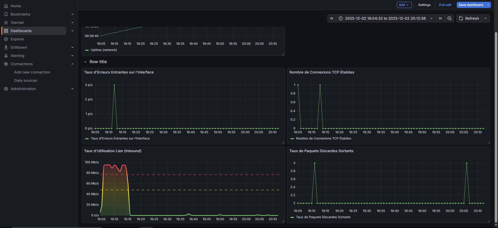

# 6. Grafana dashboards

[](README.md)
[](README.en.md)

Grafana reads the Zabbix data and shows it in clear dashboards for the network team.

| Setting | Value |
|---|---|
| Server | `dingo-grafana.webdingo.ca` (Ubuntu 22.04) |
| IP address | 192.168.5.17/24 |
| Access | `http://192.168.5.17:3000` |

## Installation

Official Grafana repository, with its signing key (the `apt-key` method is deprecated):

```bash
sudo apt-get update
sudo apt-get install -y apt-transport-https software-properties-common wget gpg
sudo mkdir -p /etc/apt/keyrings
wget -q -O - https://apt.grafana.com/gpg.key | gpg --dearmor | sudo tee /etc/apt/keyrings/grafana.gpg > /dev/null
echo "deb [signed-by=/etc/apt/keyrings/grafana.gpg] https://apt.grafana.com stable main" | sudo tee /etc/apt/sources.list.d/grafana.list
sudo apt-get update
sudo apt-get install -y grafana
```

Start the service and enable it at boot:

```bash
sudo systemctl enable --now grafana-server
sudo systemctl status grafana-server
```

Grafana listens on port 3000. The default account is `admin` / `admin`: change the password at the
first login.

## Zabbix plugin

The plugin lets Grafana read the Zabbix data:

```bash
sudo grafana-cli plugins install alexanderzobnin-zabbix-app
sudo systemctl restart grafana-server
```

Then enable it in *Administration > Plugins > Zabbix > Enable*.

## Zabbix data source

1. In Zabbix, create a user dedicated to Grafana, **read-only** on the hosts,
   and generate an API token for it (*Users > API tokens*). A token is cleaner than a password.
2. In Grafana: *Connections > Data sources > Add data source > Zabbix*.
3. URL: `https://192.168.5.100/zabbix/api_jsonrpc.php`
4. Authentication: the API token, then **Save & test**.

## My dashboard

It follows the metrics of my part (network and security): uptime, inbound error rate on the
interface, number of established TCP connections, link utilization (inbound) with the
Warning (yellow) and High (red) thresholds, and outbound dropped packets.

It shows the saturation test: the inbound link climbs towards 100 Mbit/s for a few
minutes, crosses both thresholds, then returns to normal.



The team also prepared two views: *Direction* (management, overall status) and *Technique*
(technical, detail per device).
