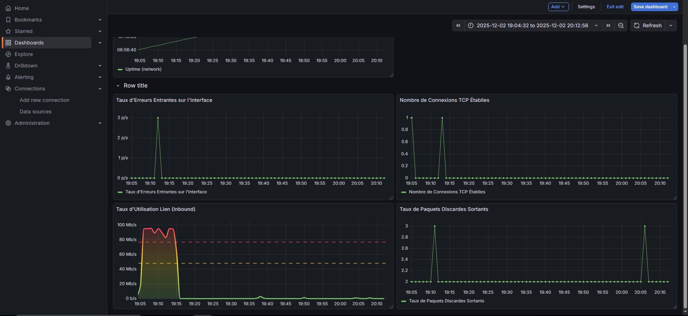

# 6. Tableaux de bord Grafana

[](README.md)
[](README.en.md)

Grafana lit les données de Zabbix et les affiche en tableaux de bord clairs pour l'équipe réseau.

| Paramètre | Valeur |
|---|---|
| Serveur | `dingo-grafana.webdingo.ca` (Ubuntu 22.04) |
| Adresse IP | 192.168.5.17/24 |
| Accès | `http://192.168.5.17:3000` |

## Installation

Dépôt officiel de Grafana, avec sa clé de signature (la méthode `apt-key` est dépréciée) :

```bash
sudo apt-get update
sudo apt-get install -y apt-transport-https software-properties-common wget gpg
sudo mkdir -p /etc/apt/keyrings
wget -q -O - https://apt.grafana.com/gpg.key | gpg --dearmor | sudo tee /etc/apt/keyrings/grafana.gpg > /dev/null
echo "deb [signed-by=/etc/apt/keyrings/grafana.gpg] https://apt.grafana.com stable main" | sudo tee /etc/apt/sources.list.d/grafana.list
sudo apt-get update
sudo apt-get install -y grafana
```

Démarrer le service et l'activer au démarrage :

```bash
sudo systemctl enable --now grafana-server
sudo systemctl status grafana-server
```

Grafana écoute sur le port 3000. Le compte par défaut est `admin` / `admin` : changer le mot de passe dès la
première connexion.

## Plugin Zabbix

Le plugin permet à Grafana de lire les données de Zabbix :

```bash
sudo grafana-cli plugins install alexanderzobnin-zabbix-app
sudo systemctl restart grafana-server
```

Puis l'activer dans *Administration > Plugins > Zabbix > Enable*.

## Source de données Zabbix

1. Dans Zabbix, créer un utilisateur réservé à Grafana, en **lecture seule** sur les hôtes,
   et lui générer un jeton API (*Users > API tokens*). Le jeton est plus propre qu'un mot de passe.
2. Dans Grafana : *Connections > Data sources > Add data source > Zabbix*.
3. URL : `https://192.168.5.100/zabbix/api_jsonrpc.php`
4. Authentification : le jeton API, puis **Save & test**.

## Mon tableau de bord

Il suit les métriques de ma partie (réseau et sécurité) : uptime, taux d'erreurs entrantes sur
l'interface, nombre de connexions TCP établies, taux d'utilisation du lien (entrant) avec les
seuils Warning (jaune) et High (rouge), et paquets rejetés sortants.

On y voit le test de saturation : le lien entrant monte vers 100 Mbit/s pendant quelques
minutes, dépasse les deux seuils, puis revient à la normale.



L'équipe a aussi préparé deux vues : *Direction* (état général) et *Technique* (détail par équipement).
