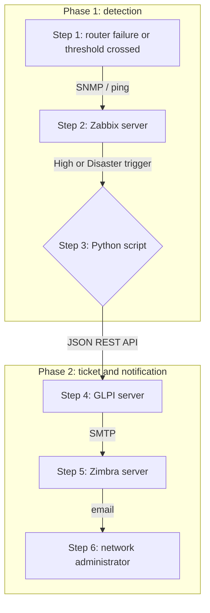

# 7. Automation and incident management (Python)

[](README.md)
[](README.en.md)

To meet the responsiveness requirements of WebDingo, an automation layer runs on a
dedicated virtual machine (`srv-python`, 192.168.5.16). It has two functions:
user synchronization and automatic incident management.

## Alert flow



## Scripts

| Script | Role |
|---|---|
| [glpi_automation.py](glpi_automation.py) | Zabbix to GLPI gateway: creates the incident ticket |
| [import_ad_users.py](import_ad_users.py) | Imports the AD users into GLPI and creates the groups based on the OUs |
| [link_users_groups.py](link_users_groups.py) | Attaches each user to the group of their OU |
| [fix_emails.py](fix_emails.py) | Forces the `login_AD@webdingo.ca` email so that Zimbra delivers the alerts |
| [config.py](config.py), [glpi_client.py](glpi_client.py) | Settings (environment variables) and GLPI API access |

### glpi_automation.py

When a trigger reaches the *High* or *Disaster* severity, a Zabbix action runs the script
with 4 arguments: host, trigger name, value, severity. The script:

1. authenticates to the GLPI REST API (App-Token and User-Token);
2. converts the Zabbix severity into a GLPI priority (Warning = 2 ... Disaster = 5);
3. creates the incident ticket, assigned to the *Admins* group and linked to the router in the inventory;
4. adds diagnostic tasks based on the priority, for example "Vérifier les logs du routeur"
   (check the router logs), "Confirmer le statut des interfaces Gi0/1 et Gi0/0" (confirm the
   status of the Gi0/1 and Gi0/0 interfaces), "Escalader l'incident" (escalate the incident).

### AD synchronization

- **Import and linking**: AD is read over LDAP, the groups (Ventes, Marketing...) are created
  in GLPI and the users are added according to their OU.
- **Email correction**: every address in GLPI is forced to the
  `login_AD@webdingo.ca` format, which guarantees that the alerts reach Zimbra.

## Usage

```bash
cd 07-automation-python
python3 -m venv .venv && . .venv/bin/activate
pip install -r requirements.txt
cp ../.env.example ../.env      # puis remplir les jetons et le compte de service
set -a; . ../.env; set +a
python3 glpi_automation.py "Routeur 1" "Saturation du lien entrant" "92" "High"
```

The comment in the `cp` line means: then fill in the tokens and the service account.

## Improvements made to the submitted code

- **No secret in the code**: the GLPI tokens and the AD account were written in clear text in
  every script; they now come from environment variables (`.env`, ignored by git).
- Shared code grouped (`config.py`, `glpi_client.py`) instead of being copied into 4 files.
- Timeout on every request, and TLS verification that can be enabled (`GLPI_VERIFY_TLS=1`).
- Fixed the entry point (`if __name__ == "__main__"`) and the indentation.
- `glpi_automation.py` tested against a simulated GLPI API: authentication, ticket, 3 tasks and
  session closing; it fails cleanly if the arguments or the tokens are wrong.
