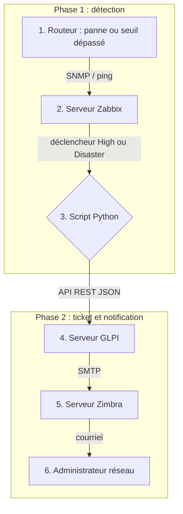

# 7. Automatisation et gestion des incidents (Python)

Pour répondre aux exigences de réactivité de WebDingo, une couche d'automatisation tourne sur
une machine virtuelle dédiée (`srv-python`, 192.168.5.16). Elle assure deux fonctions :
la synchronisation des utilisateurs et la gestion automatique des incidents.

## Flux d'une alerte



## Scripts

| Script | Rôle |
|---|---|
| [glpi_automation.py](glpi_automation.py) | Passerelle Zabbix vers GLPI : crée le ticket d'incident |
| [import_ad_users.py](import_ad_users.py) | Importe les utilisateurs AD dans GLPI et crée les groupes d'après les OU |
| [link_users_groups.py](link_users_groups.py) | Rattache chaque utilisateur au groupe de son OU |
| [fix_emails.py](fix_emails.py) | Force le courriel `login_AD@webdingo.ca` pour que Zimbra livre les alertes |
| [config.py](config.py), [glpi_client.py](glpi_client.py) | Paramètres (variables d'environnement) et accès à l'API GLPI |

### glpi_automation.py

Quand un déclencheur atteint la sévérité *High* ou *Disaster*, une action Zabbix lance le script
avec 4 arguments : hôte, nom du déclencheur, valeur, sévérité. Le script :

1. s'authentifie à l'API REST de GLPI (App-Token et User-Token) ;
2. convertit la sévérité Zabbix en priorité GLPI (Warning = 2 … Disaster = 5) ;
3. crée le ticket d'incident, assigné au groupe *Admins* et lié au routeur dans l'inventaire ;
4. ajoute des tâches de diagnostic selon la priorité, par exemple « Vérifier les logs du routeur »,
   « Confirmer le statut des interfaces Gi0/1 et Gi0/0 », « Escalader l'incident ».

### Synchronisation AD

- **Importation et liaison** : lecture de l'AD en LDAP, création des groupes (Ventes, Marketing…)
  dans GLPI et ajout des utilisateurs selon leur OU.
- **Correction des courriels** : chaque adresse dans GLPI est forcée au format
  `login_AD@webdingo.ca`, ce qui garantit que les alertes arrivent dans Zimbra.

## Utilisation

```bash
cd 07-automation-python
python3 -m venv .venv && . .venv/bin/activate
pip install -r requirements.txt
cp ../.env.example ../.env      # puis remplir les jetons et le compte de service
set -a; . ../.env; set +a
python3 glpi_automation.py "Routeur 1" "Saturation du lien entrant" "92" "High"
```

## Améliorations apportées au code du rendu

- **Aucun secret dans le code** : les jetons GLPI et le compte AD étaient écrits en clair dans
  chaque script ; ils viennent maintenant de variables d'environnement (`.env`, ignoré par git).
- Code commun regroupé (`config.py`, `glpi_client.py`) au lieu d'être copié dans 4 fichiers.
- Délai maximal sur chaque requête, et vérification TLS activable (`GLPI_VERIFY_TLS=1`).
- Correction du point d'entrée (`if __name__ == "__main__"`) et de l'indentation.
- `glpi_automation.py` testé contre une API GLPI simulée : authentification, ticket, 3 tâches et
  fermeture de session ; il échoue proprement si les arguments ou les jetons sont mauvais.
