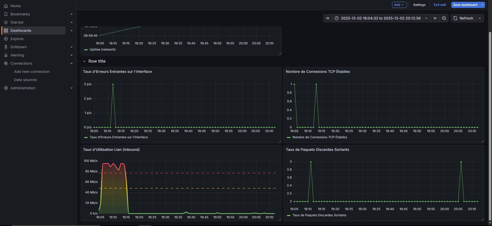
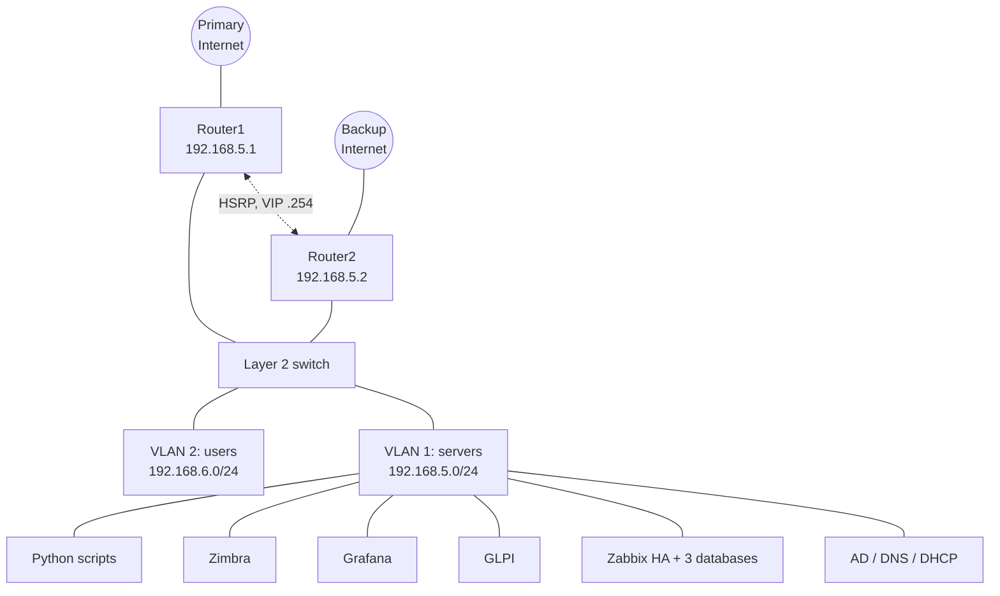

# WebDingo NOC Lab

[Version française](README.md) · English

**Redundant network infrastructure and high-availability monitoring**

Cisco HSRP · VLAN · Zabbix HA · Grafana · GLPI · Active Directory · Zimbra · Python

Capstone project of a three-year IT technology diploma (networking option), built by a team of
three. We were responsible for every network system of a fictional company, **WebDingo
Solutions Inc.**: a redundant Cisco network, core services (Active Directory, DNS, DHCP, email)
and the network operations center (**NOC**): metric collection, alerting, dashboards and
automatic incident tickets.

The goal: stop learning about an outage when users call, and instead see it coming, get alerted
automatically and keep a record of every incident.

## My role: network and security

- **Cisco equipment**: both routers and the switch, VLANs, 802.1Q trunks, HSRP redundancy with
  WAN link tracking, NAT over two Internet uplinks.
- **SNMP hardening**: read-only community, restricted to the Zabbix server, traps to Zabbix.
- **Traffic monitoring**: Zabbix items and triggers for TCP connections, interface errors,
  discarded packets and link utilization (inbound and outbound), to spot saturation or a
  denial-of-service attack.
- **Grafana dashboard** for these metrics, with Warning and High thresholds.

The rest of the project (Windows services and Zimbra, GLPI, Python scripts, other metrics) was
built by my teammates; it is documented here because everything works together.

## Architecture

| Role | Name | OS | IP address |
|---|---|---|---|
| Primary router | Routeur1 | Cisco IOS | 192.168.5.1 / 192.168.6.1 |
| Backup router | Routeur2 | Cisco IOS | 192.168.5.2 / 192.168.6.2 |
| HSRP virtual gateway | | | 192.168.5.254 / 192.168.6.254 |
| Layer 2 switch | Switch | Cisco IOS | 192.168.6.177 |
| AD / DNS / DHCP | srv-ad | Windows Server 2022 | 192.168.5.50 |
| Zabbix (2 nodes) | srv-zabbix-1, srv-zabbix-2 | AlmaLinux 9 | 192.168.5.21, .22 (access: .100) |
| Zabbix databases | srv-db1 to srv-db3 | Ubuntu 22.04 | 192.168.5.11 to .13 |
| GLPI | dingo-glpi | Ubuntu 22.04 | 192.168.5.14 |
| Email | srv-zimbra | Ubuntu 22.04 | 192.168.5.15 |
| Python scripts | srv-python | Ubuntu 22.04 | 192.168.5.16 |
| Grafana | dingo-grafana | Ubuntu 22.04 | 192.168.5.17 |

## Documentation (in French)

| Step | Content |
|---|---|
| [1. Cisco network](01-network-cisco/) | Cabling, VLANs, HSRP, NAT, SNMP, configurations |
| [2. AD, DNS, DHCP](02-identity-ad/) | Domain controller, `webdingo.ca` zone, DHCP scopes |
| [3. Zimbra](03-mail-zimbra/) | Email, AD integration, automatic account provisioning |
| [4. GLPI](04-itsm-glpi/) | Tickets, inventory, AD (LDAP) login |
| [5. Zabbix](05-monitoring-zabbix/) | High availability, metrics, thresholds, triggers |
| [6. Grafana](06-dashboards-grafana/) | Zabbix plugin, dashboards |
| [7. Automation](07-automation-python/) | Zabbix to GLPI to Zimbra, Python scripts |
| [8. Incident runbooks](08-runbooks/) | What to do when an alert fires: check, act, escalate |
| [HSRP failover tests](01-network-cisco/tests-bascule-hsrp.md) | Proving redundancy: link down, router powered off |

## Alert pipeline

Zabbix detects a router failure (SNMP, ping). When the trigger is *High* or *Disaster*, a Python
script creates a GLPI ticket with the right priority and diagnostic tasks, and the team is
notified by email through Zimbra.

## What I learned

- Redundancy is only complete when **everything** uses it: HSRP is useless if DHCP hands out a
  router's real address instead of the virtual one.
- Every threshold needs a reason: a Warning fires before users feel the problem, a High means
  real impact.
- Monitoring is also documentation: without a ticket and a history, a fixed incident is a
  forgotten incident.

## Security of this repository

Lab environment only (private addresses, fictional domain). The passwords, SNMP community and
API tokens of the original project were removed: configurations use `<PLACEHOLDER>` values and
the scripts read their secrets from environment variables. A CI check fails if a secret or a
broken link is ever committed.
