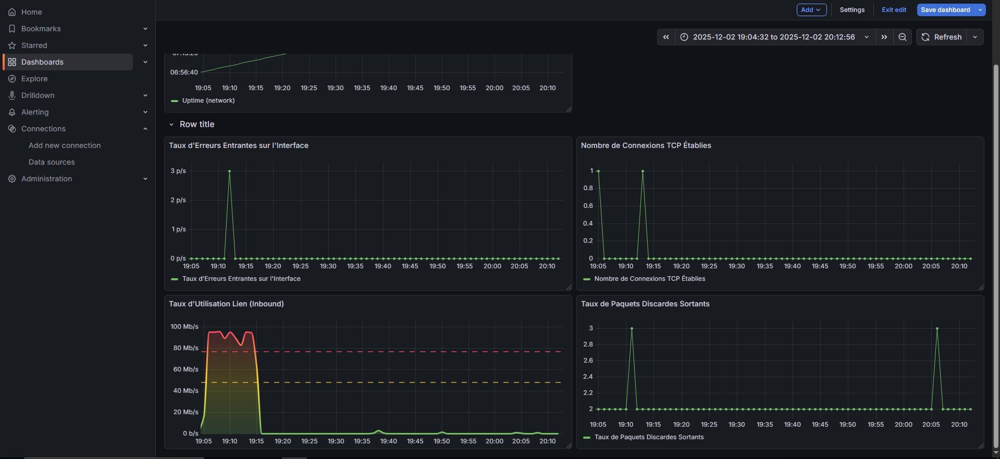
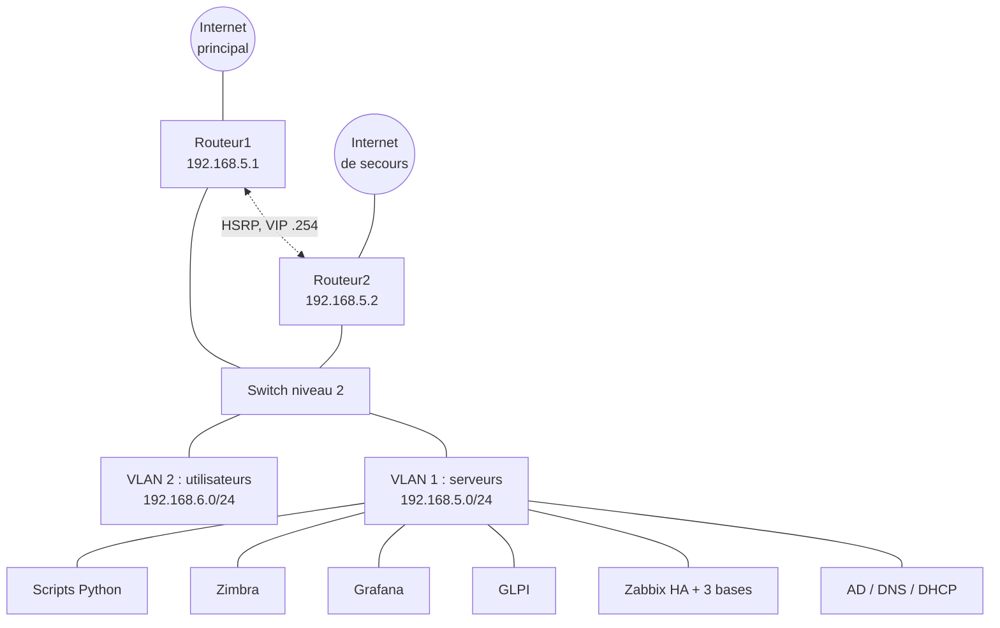

# WebDingo NOC Lab

[](README.md)
[](README.en.md)

**Infrastructure réseau redondante et supervision en haute disponibilité**

Cisco HSRP · VLAN · Zabbix HA · Grafana · GLPI · Active Directory · Zimbra · Python

| Élément | Contenu |
|---|---|
| Objectif | Concevoir le réseau redondant et le centre de supervision (NOC) d'une entreprise fictive : voir venir les pannes, alerter automatiquement et tracer chaque incident |
| Technologies | Cisco IOS (HSRP, VLAN, 802.1Q, NAT, SNMP), Windows Server 2022 (AD, DNS, DHCP), Zabbix en haute disponibilité, Grafana, GLPI, Zimbra, Python, AlmaLinux 9, Ubuntu 22.04 |
| Niveau | Avancé |
| Contenu | Un dossier par service (README, configurations, captures), tests de bascule HSRP, runbooks d'incident, scripts Python, CI anti-secrets |
| Statut | Terminé (version 1.0.0 publiée le 2026-11-22, voir le [journal des modifications](CHANGELOG.md)) |
| Lire en premier | [1. Réseau Cisco](01-network-cisco/README.md) |

Projet intégrateur de fin de DEC en Techniques de l'informatique (réseautique), réalisé en
équipe de trois. Notre équipe était responsable de tous les systèmes réseau de l'entreprise
fictive **WebDingo Solutions Inc.** : un réseau Cisco redondant, les services de base
(Active Directory, DNS, DHCP, messagerie) et le centre de supervision réseau (**NOC**) :
collecte des métriques, alertes, tableaux de bord et tickets d'incident automatiques.

Le but : ne plus découvrir un problème seulement quand les utilisateurs appellent, mais le voir
venir, être alerté automatiquement et garder une trace de chaque incident.



## Mon rôle : réseau et sécurité

- **Équipements Cisco** : configuration des deux routeurs et du switch, VLAN, trunks 802.1Q,
  redondance HSRP avec suivi du lien Internet, NAT sur deux accès Internet.
- **Sécurisation de SNMP** : communauté en lecture seule, limitée au serveur Zabbix, traps vers Zabbix.
- **Supervision des flux** : métriques et déclencheurs Zabbix pour les connexions TCP, les erreurs
  d'interface, les paquets rejetés et le taux d'utilisation du lien (entrant et sortant), pour
  repérer une saturation ou une attaque par déni de service.
- **Tableau de bord Grafana** de ces métriques, avec les seuils Warning et High.

Le reste du projet (services Windows et Zimbra, GLPI, scripts Python, autres métriques) a été
réalisé par mes coéquipiers ; il est documenté ici parce que tout fonctionne ensemble.

## Architecture



| Rôle | Nom | Système | Adresse IP |
|---|---|---|---|
| Routeur principal | Routeur1 | Cisco IOS | 192.168.5.1 / 192.168.6.1 |
| Routeur de secours | Routeur2 | Cisco IOS | 192.168.5.2 / 192.168.6.2 |
| Passerelle virtuelle HSRP | | | 192.168.5.254 / 192.168.6.254 |
| Switch niveau 2 | Switch | Cisco IOS | 192.168.6.177 |
| AD / DNS / DHCP | srv-ad | Windows Server 2022 | 192.168.5.50 |
| Zabbix (2 nœuds) | srv-zabbix-1, srv-zabbix-2 | AlmaLinux 9 | 192.168.5.21, .22 (accès : .100) |
| Bases de données Zabbix | srv-db1 à srv-db3 | Ubuntu 22.04 | 192.168.5.11 à .13 |
| GLPI | dingo-glpi | Ubuntu 22.04 | 192.168.5.14 |
| Messagerie | srv-zimbra | Ubuntu 22.04 | 192.168.5.15 |
| Scripts Python | srv-python | Ubuntu 22.04 | 192.168.5.16 |
| Grafana | dingo-grafana | Ubuntu 22.04 | 192.168.5.17 |

## Documentation

| Étape | Contenu |
|---|---|
| [1. Réseau Cisco](01-network-cisco/) | Câblage, VLAN, HSRP, NAT, SNMP, configurations |
| [2. AD, DNS, DHCP](02-identity-ad/) | Contrôleur de domaine, zone `webdingo.ca`, étendues DHCP |
| [3. Zimbra](03-mail-zimbra/) | Messagerie, intégration AD, création automatique des comptes |
| [4. GLPI](04-itsm-glpi/) | Tickets, inventaire, connexion à l'AD |
| [5. Zabbix](05-monitoring-zabbix/) | Haute disponibilité, métriques, seuils, déclencheurs |
| [6. Grafana](06-dashboards-grafana/) | Plugin Zabbix, tableaux de bord |
| [7. Automatisation](07-automation-python/) | Zabbix vers GLPI vers Zimbra, scripts Python |
| [8. Runbooks d'incident](08-runbooks/) | Que faire quand une alerte sonne : vérifier, agir, escalader |
| [Tests de bascule HSRP](01-network-cisco/tests-bascule-hsrp.md) | Prouver la redondance : lien coupé, routeur éteint |

## Chaîne d'alerte

Une panne sur un routeur est détectée par Zabbix (SNMP, ping). Si le déclencheur est *High* ou
*Disaster*, un script Python crée automatiquement un ticket GLPI avec la bonne priorité et des
tâches de diagnostic, et l'équipe est prévenue par courriel via Zimbra.


## Contenu du dépôt

```text
webdingo-noc-lab/
├── 01-network-cisco/          routeurs HSRP, switch, VLAN, NAT, SNMP
│   ├── configs/               routeur1.cfg, routeur2.cfg, switch.cfg
│   └── tests-bascule-hsrp.md  tests de bascule HSRP : lien coupé, routeur éteint
├── 02-identity-ad/            Active Directory, DNS, DHCP  (images/)
├── 03-mail-zimbra/            messagerie, création automatique des comptes  (configs/, images/)
├── 04-itsm-glpi/              tickets, inventaire, connexion LDAP  (images/)
├── 05-monitoring-zabbix/      haute disponibilité, métriques, seuils, déclencheurs  (images/)
├── 06-dashboards-grafana/     tableaux de bord  (images/)
├── 07-automation-python/      scripts Zabbix -> GLPI et synchronisation AD
├── 08-runbooks/               procédures d'incident pour chaque alerte
├── .github/                   CI : compilation Python, détection de secrets, liens Markdown
├── .env.example               variables à remplir pour les scripts (le vrai .env n'est jamais publié)
├── CHANGELOG.md               journal des modifications
├── SECURITY.md                portée du laboratoire et signalement d'un problème
├── LICENSE                    licence MIT
├── README.md                  version française (ce fichier)
└── README.en.md               version anglaise
```

Chaque dossier a son propre README, ses configurations et ses captures d'écran :

| Dossier | README |
|---|---|
| `01-network-cisco/` | [01-network-cisco/README.md](01-network-cisco/README.md) |
| `02-identity-ad/` | [02-identity-ad/README.md](02-identity-ad/README.md) |
| `03-mail-zimbra/` | [03-mail-zimbra/README.md](03-mail-zimbra/README.md) |
| `04-itsm-glpi/` | [04-itsm-glpi/README.md](04-itsm-glpi/README.md) |
| `05-monitoring-zabbix/` | [05-monitoring-zabbix/README.md](05-monitoring-zabbix/README.md) |
| `06-dashboards-grafana/` | [06-dashboards-grafana/README.md](06-dashboards-grafana/README.md) |
| `07-automation-python/` | [07-automation-python/README.md](07-automation-python/README.md) |
| `08-runbooks/` | [08-runbooks/README.md](08-runbooks/README.md) |

## Ce que ce projet m'a appris

- Une redondance n'est complète que si **tout** l'utilise : HSRP ne sert à rien si le DHCP
  distribue l'adresse réelle d'un routeur au lieu de l'adresse virtuelle.
- Un seuil doit se justifier : chaque alerte Warning prévient avant que l'utilisateur ne
  ressente le problème, chaque alerte High signale un impact réel.
- Superviser, c'est aussi documenter : sans ticket ni historique, un incident réglé est un
  incident oublié.

## Sécurité de ce dépôt

Environnement de laboratoire uniquement (adresses privées, domaine fictif). Les mots de passe,
la communauté SNMP et les jetons d'API du projet d'origine ont été retirés : les configurations
utilisent des valeurs `<À_REMPLACER>` et les scripts lisent leurs secrets dans des variables
d'environnement. Une vérification automatique (CI) échoue si un secret ou un lien cassé
est un jour commité.
